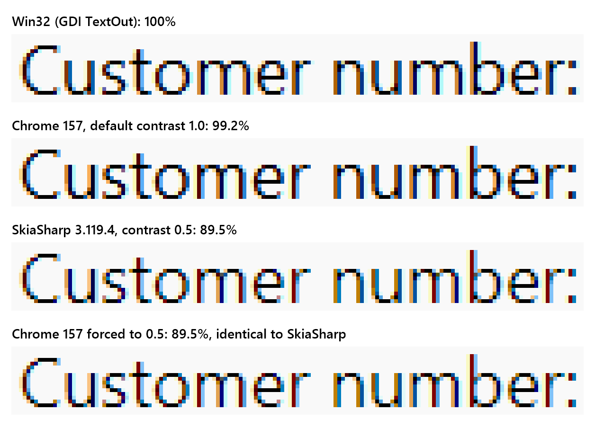

# Windows: text is washed out; build Skia with SK_GAMMA_CONTRAST=1.0, as Chromium does

On Windows, text drawn with SkiaSharp is about 10% lighter than the same text in Win32 apps, Chrome and Edge. Chrome, Edge, WebView2, Electron apps and Firefox all use 1.0 on Windows; SkiaSharp is still on 0.5.

Chrome and Edge had exactly this problem, and fixed it:

| | Skia text contrast | Text on Windows |
|---|---|---|
| Chrome and Edge before 132 | 0.5 | lighter than Windows |
| Chrome and Edge 132 and later | 1.0 | matches Windows |
| SkiaSharp today | 0.5 | lighter than Windows |

The fix was one define in Chromium's Skia build, `SK_GAMMA_CONTRAST=0.5` (Skia's default) to `1.0` ([commit c0742f5](https://github.com/chromium/chromium/commit/c0742f5eba9065435d55c6ef1f0693b11dca8963), [review](https://chromium-review.googlesource.com/c/chromium/src/+/6172587), [crbug 40037626](https://issues.chromium.org/issues/40037626)):

- [Chrome blog](https://developer.chrome.com/blog/better-text-rendering-in-chromium-based-browsers-on-windows) (12 February 2025):
  - "many Edge users shared that text appeared 'washed out' and that it didn't look consistent with text in other parts of Windows."
  - "Skia does not pick up text contrast and gamma values from the Windows ClearType Tuner."
  - "After a lot of user research, members of both Edge and Chromium determined that a contrast value of 1.0 closely matched the text rendering of pre-Chromium Edge and looked consistent compared to other native Windows applications."
  - "we shared our findings with the Chrome team at Google, who confirmed them with their own experiments."
- [Edge blog](https://blogs.windows.com/msedgedev/2025/01/30/better-text-contrast-for-all-chromium-based-browsers-on-windows/) (30 January 2025):
  - "This led to lighter text rendering in Chromium, especially noticeable in CJK characters."
  - "The contrast ratio between the text and its background is therefore very important to ensure comfort and to reduce eye strain."
  - "increasing the contrast value to 1.0 significantly enhances text visibility, particularly in scenarios involving lighter-weight text and CJK languages, which we heard a lot of feedback about."

### Proposal

Do the same in [`native/windows/build.cake`](https://github.com/mono/SkiaSharp/blob/68dee5b936dedfbfd27106ddfa6561a35735f3fb/native/windows/build.cake#L88):

```diff
- $"extra_cflags=[ '-DSKIA_C_DLL', '-DSK_AVOID_SLOW_RASTER_PIPELINE_BLURS', ...
+ $"extra_cflags=[ '-DSKIA_C_DLL', '-DSK_GAMMA_CONTRAST=1.0', '-DSK_AVOID_SLOW_RASTER_PIPELINE_BLURS', ...
```

Windows only, no API change.

### Impact

The text contrast is fixed when SkiaSharp is built, and `SKSurfaceProperties` does not expose it, so libraries and applications built on SkiaSharp cannot correct it themselves. This includes Avalonia, Uno Platform's Skia renderer, SkiaSharp's MAUI views, and charting and mapping libraries such as ScottPlot, LiveCharts2 and Mapsui. With this change, all of them render text on Windows with the same contrast as Chrome, Edge, WebView2, Electron and Firefox, without any change on their side.

### Measurements

12 px Segoe UI, black on #F9F9F9, subpixel anti-aliasing, 150%, Windows 11 24H2:

| Renderer | Ink, relative to Win32 |
|---|---|
| Win32 (GDI `TextOut`) | 100% |
| Edge 157 (default, 1.0) | 99.7% |
| Chrome 157 (default, 1.0) | 99.7% |
| **SkiaSharp 3.119.4 (0.5)** | **89.8%** |
| Chrome 157 forced back to 0.5 with `--text-contrast=0.5`, as before 132 | 89.8% |

Ink is each pixel's darkness from the background (0) to black (1), summed.



"Customer number:" at 12 px, magnified 8 times. From the top: Win32, Chrome (1.0), SkiaSharp (0.5), Chrome forced to 0.5. Only the edge pixels differ, and SkiaSharp and Chrome at 0.5 are identical.
"Customer number:" at other sizes, ink relative to Win32:

| Size | SkiaSharp (0.5) | Chrome (1.0) |
|---|---|---|
| 8 px | 81.0% | 93.0% |
| 10 px | 92.9% | 104.9% |
| 12 px | 89.5% | 99.2% |
| 14 px | 89.9% | 101.8% |
| 16 px | 90.2% | 101.1% |
| 20 px | 93.6% | 101.0% |
| 28 px | 94.4% | 100.3% |

At every line and size, SkiaSharp is identical pixel for pixel to Chrome and Edge with `--text-contrast=0.5`. The gap is largest on small text.

### Examples of projects that use 1.0 on Windows

| Project | Contrast on Windows | Change |
|---|---|---|
| Chrome and Edge 132 and later | 1.0 | a runtime flag from 132 ([commit 6e86a15](https://github.com/chromium/chromium/commit/6e86a151bfcccb93f3af3f679064ed8a59af824e)), built in from 134 ([commit c0742f5](https://github.com/chromium/chromium/commit/c0742f5eba9065435d55c6ef1f0693b11dca8963)), [Chrome blog](https://developer.chrome.com/blog/better-text-rendering-in-chromium-based-browsers-on-windows), [Edge blog](https://blogs.windows.com/msedgedev/2025/01/30/better-text-contrast-for-all-chromium-based-browsers-on-windows/) |
| Electron 35 and later (VS Code, for example), WebView2 | 1.0 | inherited from Chromium's build since Chromium 134 ([c0742f5](https://github.com/chromium/chromium/commit/c0742f5eba9065435d55c6ef1f0693b11dca8963); [Electron 35](https://github.com/electron/electron/releases/tag/v35.0.0) ships Chromium 134) |
| Firefox | 1.0 (or the ClearType Tuner's value, if set), both in Skia (canvas) and in WebRender's Rust port of Skia's text gamma (page text) | [gfxDWriteFonts.cpp L192–219](https://github.com/mozilla-firefox/firefox/blob/33abb900fc1646fef2e5ffed2d6b22e806ae10c1/gfx/thebes/gfxDWriteFonts.cpp#L192-L219) |
| FerroUI (Rust port of Avalonia) | 1.0 | [commit ab0cb52](https://github.com/wieslawsoltes/FerroUI/commit/ab0cb523572f127c96df7bb2ef4f09abf2e2c04a), [measurements](https://github.com/wieslawsoltes/FerroUI/blob/c2cc7681ead9bcd63946eda178456a319de8ebad/docs/porting/text-rendering.md) |
| DioxusLabs anyrender | 1.0 | [commit f027a7e](https://github.com/DioxusLabs/anyrender/commit/f027a7e7c5cd140b82d2843f186878e293f88bdd), [#135](https://github.com/DioxusLabs/anyrender/pull/135) |

### Notes

- This isn't "match Windows for its own sake". 0.5 is Skia's untuned default, and Chromium tunes it per platform ([skia/BUILD.gn L118–150](https://github.com/chromium/chromium/blob/de958f7853ffce8b325cdd7b00cb0840470e27bb/skia/BUILD.gn#L118-L150)): 1.0 on Windows, 0.0 on macOS and Android, 0.2 on Linux.
- Skia's own comment ([SkTypes.h L88–94](https://github.com/mono/skia/blob/7329f82be5f66b326acdfadbc87a62793e6d6dba/include/core/SkTypes.h#L88-L94)) says lower values make small text look "washed out" and higher values make LCD fringing worse. The fringes at 1.0 were no stronger than at 0.5 at any size from 8 to 28 px. Per pixel (largest channel minus smallest), the strongest is 177–185 at 1.0, 177 in Win32 and 193 at 0.5. Only black text was measured.
- It affects all anti-aliased text SkiaSharp draws on Windows, including generated images, so some reference images will change. Chromium updated its own when it made the change.
- [#2308](https://github.com/mono/SkiaSharp/issues/2308) and [discussion #2750](https://github.com/mono/SkiaSharp/discussions/2750) are about grayscale versus subpixel anti-aliasing. This text already uses subpixel anti-aliasing.

### Repro

1. Draw "Customer number:" in 12 px Segoe UI, black on #F9F9F9, with SkiaSharp.
2. Open the same text in Chrome with `--text-contrast=0.5`, then without it.
3. SkiaSharp matches the first; Chrome's default is darker.

This repository does all of this and measures it. It is an Avalonia app that draws the lines with GDI in a plain Win32 window, in Windows Forms labels and with Avalonia, opens them in Edge and Chrome at each contrast, captures every window, and writes the tables above. On Windows with the .NET 11 SDK:

```
dotnet run -c Release --project TextContrast -- --measure results
```

`results/` holds the run behind the figures above.

In Visual Studio, Run uses the Measure launch profile, which writes `results` next to `TextContrast.slnx`.
